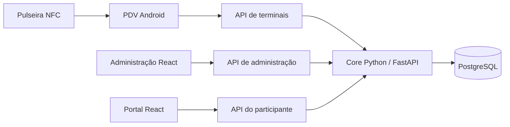

# Arquitetura e premissas verificadas

Revisão de referência: `2096ab5ad06b6dee9e2890f30fd5caec149b8318`.
Os documentos originais são propostas; diferenças abaixo precisam ser resolvidas
antes da escolha de hardware e do piloto. Os links em [fontes](fontes.md) apontam
para a revisão consultada.

O core e o banco concentram a lógica transacional. NFC identifica o participante;
o saldo é mantido pelo sistema. O checkout original contém backend, web, Android,
processadores e componentes TSE. Esta base não implementa uma segunda carteira
ou mecanismo próprio de sincronização.

| Afirmação dos materiais | Evidência consultada | Consequência para a PoC |
| --- | --- | --- |
| NTAG213/215/216 e leitor ACR1222L | O guia NFC lista MIFARE Ultralight AES MF0AES(H)20; o README descreve telefone Android com NFC | Validar tag e leitor no app antes de comprar lote; NTAG213 não está homologada |
| Vendas 100% offline com SQLite e reconciliação | O README diz que todas as transações passam pelo core; o material consultado não demonstra esse fluxo offline | Testar separadamente queda de WAN e perda da LAN/API; não prometer vendas sem servidor |
| Docker all-in-one pronto | `docker/docker-compose.devel.yaml` define apenas PostgreSQL principal e de testes | Esta base fornece banco local; APIs/web seguem execução original no host |
| Django Channels, RabbitMQ e Redis obrigatórios | README e manifesto Python indicam FastAPI/asyncpg; nenhuma necessidade desses serviços foi comprovada | Não adicionar serviços especulativos |
| React 18 e Node 20 | O manifesto web consultado usa React 19; o guia pede Node 22+ | Seguir manifesto e lockfile da revisão fixada |
| Migrações Alembic | CLI oferece `db migrate`; manifesto aponta sftkit | Usar CLI original, sem inventar migrações paralelas |
| `--without-tse` em build Android | Guia Android consultado não documenta essa opção | Confirmar mecanismo real e viabilidade de operar sem TSE antes do piloto |
| PIX e fiscal BR | Não há integração brasileira implementada nesta base | Tratar PIX automático e integração fiscal como trabalho futuro |
| 50 tx/s por PDV e transação abaixo de 1 s | Materiais trazem metas sem relatório de benchmark anexo | Medir na instalação piloto; não declarar capacidade comprovada |

A ausência de evidência no material consultado não prova que um recurso inexista
em todo o upstream. A tabela registra o que ainda depende de investigação e teste.

Para uma futura implantação: servidor e roteador em UPS, LAN dedicada, relógios
sincronizados, controle de acesso, backup e ensaio de restauração. WAN redundante
não substitui conexão entre PDVs e servidor.
